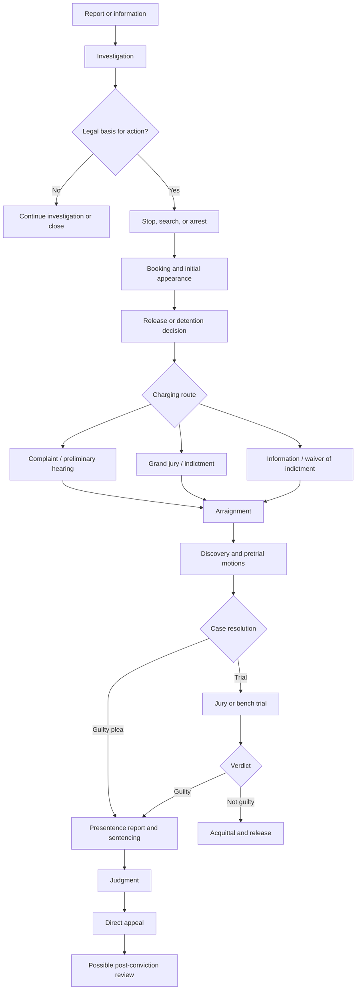

# The Full Timeline of a Federal Criminal Case
# 聯邦刑事案件完整流程

## A simplified overview
## 簡化流程概覽

A federal criminal case may follow this general sequence. Not every case uses every step, and some steps occur in a different order.
聯邦刑事案件可能依照以下一般順序進行。並非每宗案件都會經過每一個步驟，有些步驟的先後次序也可能不同。

## Stage 1 — Investigation
## 第一階段——調查

Law-enforcement officers collect information, interview witnesses, examine physical or digital evidence, and investigate whether a federal offense may have occurred.
執法人員收集資料、訪問證人、檢查實體或數位證據，並調查是否可能發生聯邦犯罪。

An investigation alone does not mean that a person has been arrested or charged.
單純受到調查，不代表某人已經被逮捕或起訴。

## Stage 2 — Stop, search, or arrest
## 第二階段——攔查、搜查或逮捕

Police action must satisfy the constitutional and statutory standard that applies to the specific action. A brief investigative stop generally requires reasonable suspicion; an arrest generally requires probable cause.
警方採取行動時，必須符合適用於該項行動的憲法及制定法標準。短暫調查性攔查通常需要合理懷疑；逮捕通常需要合理根據。

A search may require a warrant, although recognized exceptions exist.
搜查可能需要令狀，但法律承認若干例外情況。

## Stage 3 — Initial appearance and release decision
## 第三階段——首次出庭及釋放決定

After a federal arrest, Rule 5 generally requires the person to be brought before a magistrate judge without unnecessary delay. The judge advises the person of important rights and addresses release or detention.
聯邦逮捕後，第5條規則通常要求在沒有不必要延誤的情況下，將當事人帶到治安法官面前。法官會告知當事人重要權利，並處理釋放或羈押問題。

The person may be released with conditions or detained pending trial under the Bail Reform Act.
依《保釋改革法》，當事人可能在附帶條件下獲釋，也可能在審判前繼續被羈押。

## Stage 4 — Formal charging
## 第四階段——正式提出指控

A federal case may proceed by complaint, information, or indictment. In federal felony cases, an indictment is generally required unless the defendant validly waives it under Rule 7.
聯邦案件可能透過刑事申訴書、正式控告書或起訴書進行。聯邦重罪案件通常需要起訴書，除非被告依第7條規則有效放棄大陪審團起訴權。

A grand jury decides whether probable cause supports an indictment. It does not decide whether the defendant is guilty.
大陪審團決定是否有合理根據支持提出起訴書，但不負責判斷被告是否有罪。

## Stage 5 — Arraignment and pretrial preparation
## 第五階段——正式提訊及審前準備

At arraignment, the defendant is informed of the charges and enters a plea. The parties then address discovery, motions, witness issues, and trial preparation.
在正式提訊時，被告會獲告知指控內容，並作出答辯。之後雙方處理證據開示、動議、證人問題及審判準備。

## Stage 6 — Plea or trial
## 第六階段——認罪或審判

Many federal cases end in guilty pleas. If the defendant pleads not guilty and the case is not otherwise resolved, the case may proceed to a jury trial or, when properly waived, a bench trial.
許多聯邦案件以認罪答辯結束。如果被告不認罪，而案件又沒有以其他方式解決，案件可能進入陪審團審判，或在依法放棄陪審團審判權後進行法官獨任審判。

## Stage 7 — Sentencing and judgment
## 第七階段——量刑及判決

After a guilty plea or guilty verdict, the court determines the sentence under the governing statutes, constitutional rules, sentencing framework, and case-specific facts.
被告認罪或被陪審團裁定有罪後，法院會根據適用制定法、憲法規則、量刑架構及個案事實決定刑罰。

## Stage 8 — Appeal and post-conviction review
## 第八階段——上訴及定罪後審查

A defendant may have a right to direct appeal. Later collateral review may be available under narrow statutory and constitutional rules.
被告可能享有直接上訴權。之後也可能依範圍有限的制定法及憲法規則提出附帶審查。

## The most important distinction
## 最重要的區別

**An accusation is not proof. An indictment is not a verdict. An arrest is not a conviction.**
**指控不是證明。起訴書不是裁決。逮捕不是定罪。**

The government must prove every required element of the charged offense beyond a reasonable doubt at trial. The defendant does not have to prove innocence.
在審判中，政府必須排除合理懷疑地證明被控罪名的每一項必要要件。被告不必證明自己無罪。
